<a name="top"></a>

<div align="center">

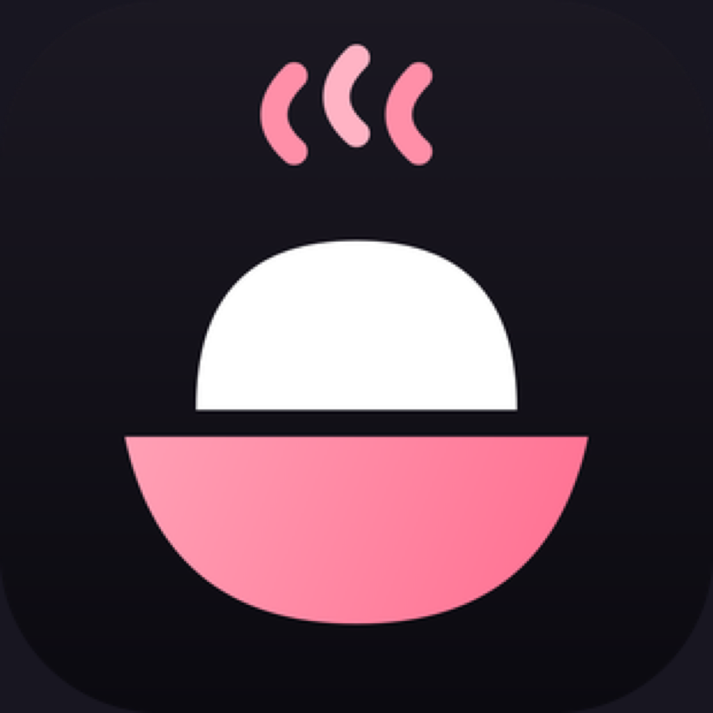

<h3>The Android / iOS / H5 client for NomiFun</h3>

<p>
  Your phone as the remote control for a local-first AI workstation —<br/>
  sessions, tasks, requirements, companions, and models all live on your <b>NomiFun Desktop</b>.
</p>

<p>
  <a href="LICENSE"></a>
  
  <a href="https://www.nomifun.com"></a>
</p>

<p>
  
  
  
  
</p>

<p>
  <a href="README.md">简体中文</a>&nbsp;·&nbsp;<b>English</b>
</p>

<p>
  <a href="https://www.nomifun.com">🌐 Website</a>&nbsp;·&nbsp;
  <a href="https://www.nomifun.com/docs/">📖 Docs</a>&nbsp;·&nbsp;
  <a href="#-getting-started">🚀 Get started</a>&nbsp;·&nbsp;
  <a href="https://github.com/nomifun/nomifun-desktop">🖥️ Desktop</a>&nbsp;·&nbsp;
  <a href="https://gitee.com/nomifun/nomifun-mobile">🇨🇳 Gitee mirror</a>
</p>

</div>

---

**NomiFun Mobile** is the Android, iOS, and H5 client for
[NomiFun Desktop](https://github.com/nomifun/nomifun-desktop). It is a **thin
client**: business logic, models, data, and long-running execution all live on
Desktop; Mobile renders state and sends commands over the same HTTP +
WebSocket API — it does not re-implement engine behavior, and it never holds a
second copy of your data or model credentials.

On a LAN the phone connects **directly** to Desktop — no NomiFun cloud relay.
Open **Connections & Devices → Connect phone** in Desktop, scan its one-time QR code
or sign in with the panel credentials, and Mobile uses the same sessions,
tasks, requirements, companions, and tools in real time.

---

## 🖼️ See the product

<div align="center">

<table>
  <tr>
    <td width="33%">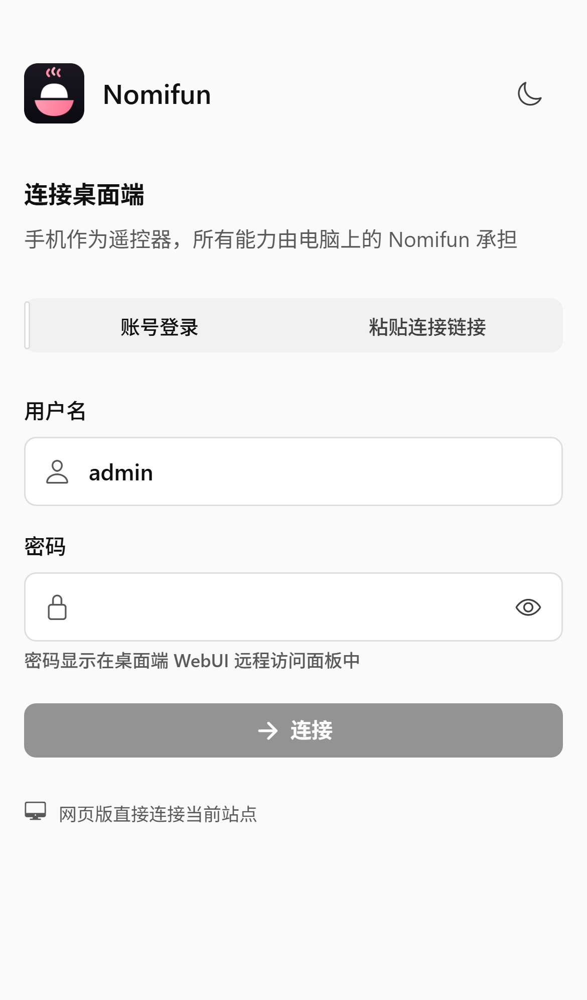<br/><sub><b>Connect</b> · QR pairing, pasted link, or account sign-in</sub></td>
    <td width="33%">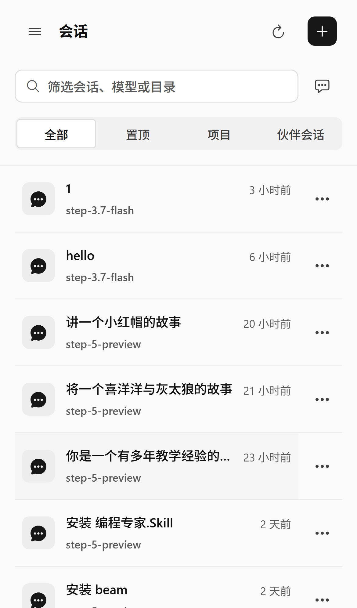<br/><sub><b>Sessions</b> · the same inbox as Desktop, filtered by project and companion</sub></td>
    <td width="33%">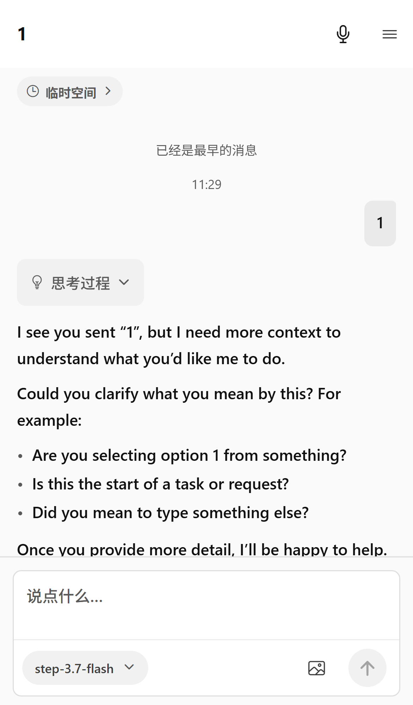<br/><sub><b>Chat</b> · streaming replies, tool calls, and approvals in real time</sub></td>
  </tr>
  <tr>
    <td width="33%">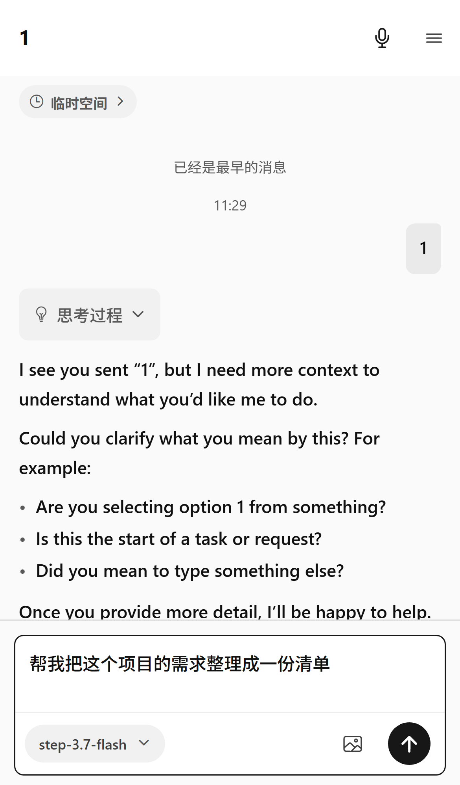<br/><sub><b>Composer</b> · pick the model per conversation, right from the phone</sub></td>
    <td width="33%">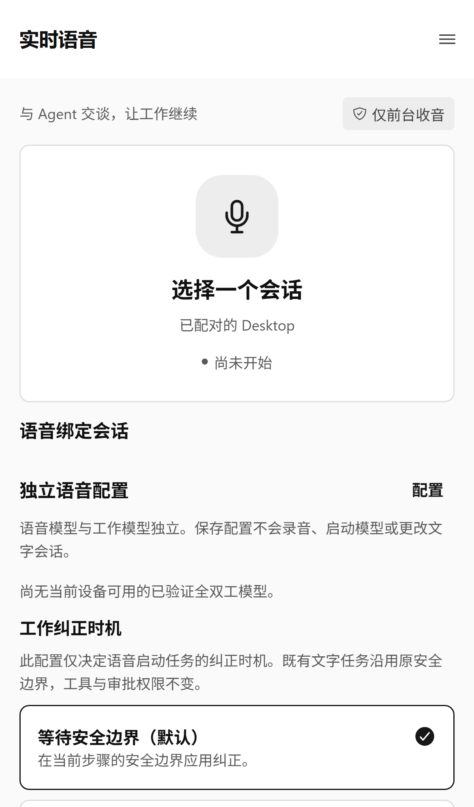<br/><sub><b>Realtime voice</b> · talk to your Agent, with configurable correction timing and safety boundary</sub></td>
    <td width="33%">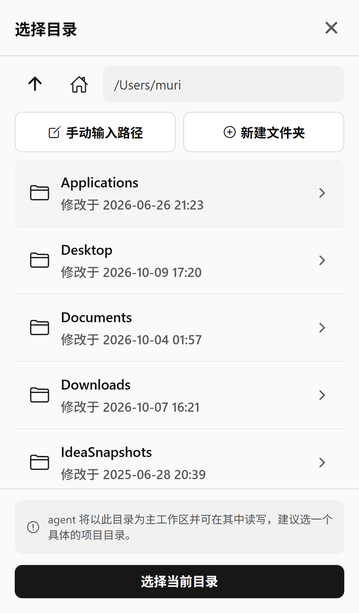<br/><sub><b>Project sessions</b> · browse the Desktop's real filesystem from the phone and bind a working directory</sub></td>
  </tr>
  <tr>
    <td width="33%">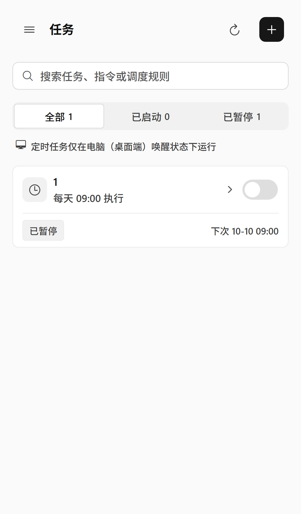<br/><sub><b>Tasks</b> · scheduled jobs with switches and run rules at a glance</sub></td>
    <td width="33%">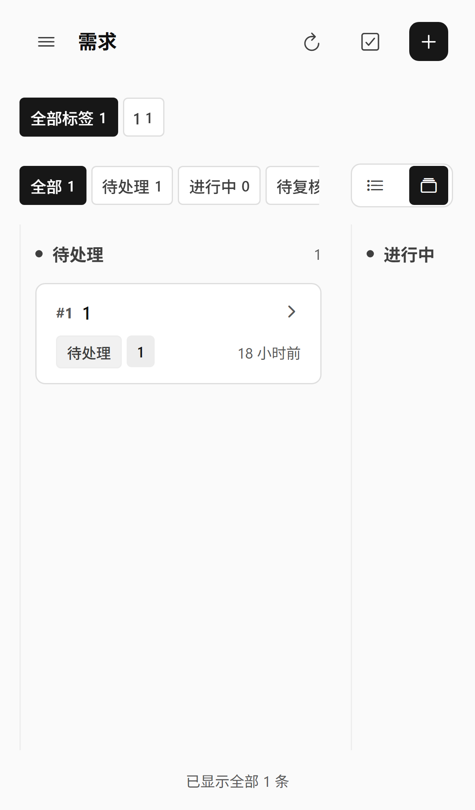<br/><sub><b>Requirements</b> · the unattended-automation inbox, on a status board</sub></td>
    <td width="33%">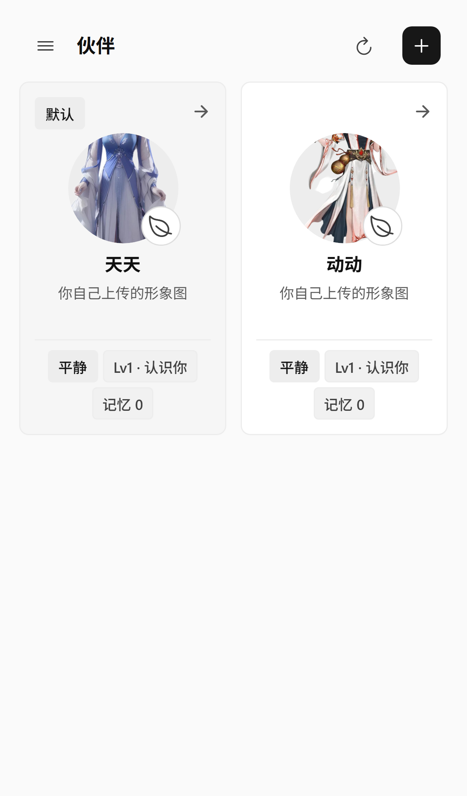<br/><sub><b>Companions</b> · the companions raised on Desktop, chat anywhere</sub></td>
  </tr>
  <tr>
    <td width="33%">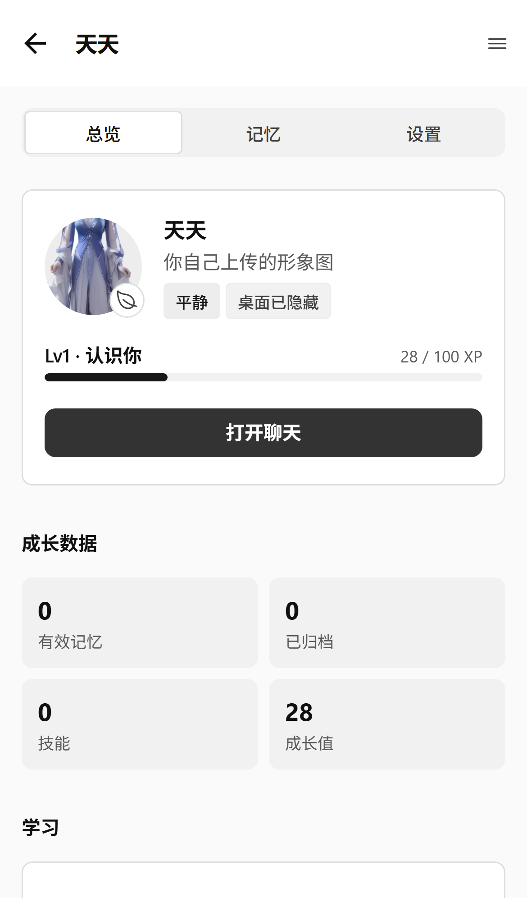<br/><sub><b>Companion growth</b> · level, XP, memory, and figure — synced from Desktop</sub></td>
    <td width="33%">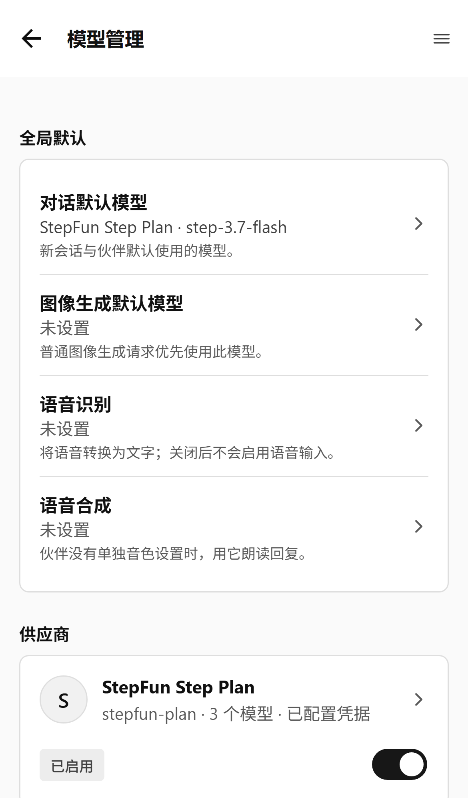<br/><sub><b>Models</b> · providers, default models, and credential status</sub></td>
    <td width="33%">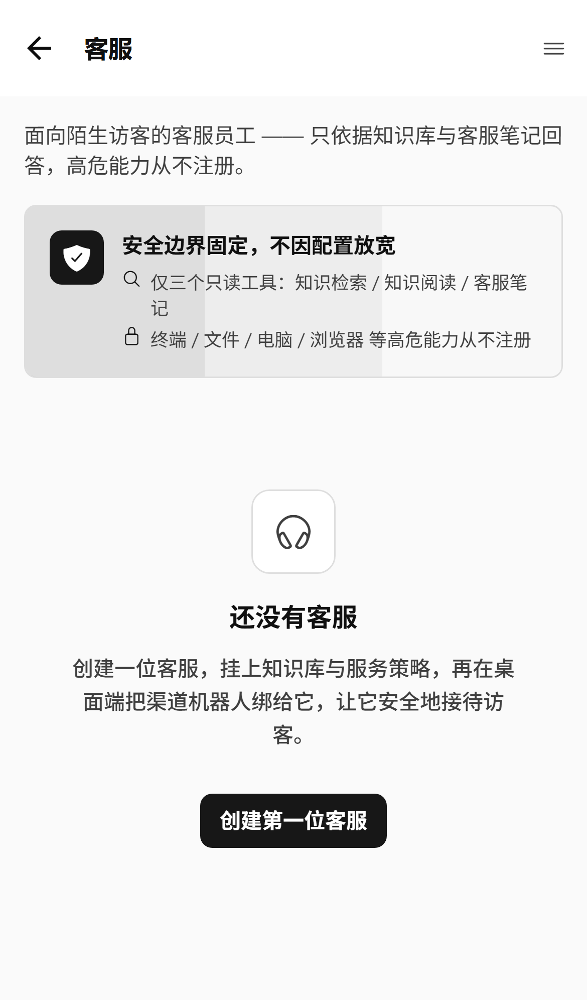<br/><sub><b>Customer service</b> · a safe visitor-facing agent — dangerous capabilities are never registered</sub></td>
  </tr>
  <tr>
    <td width="33%">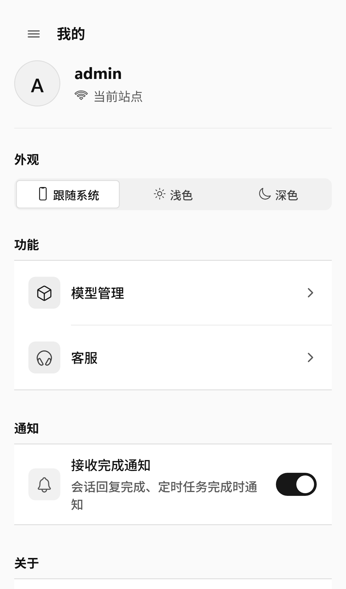<br/><sub><b>Account</b> · current site, appearance, notifications, version</sub></td>
    <td colspan="2"><sub><b>Real product, not mockups</b><br/>All captures come from the H5 build connected to a live Desktop (2026-10-10). See <a href="#verification">Verification</a> for how to reshoot.</sub></td>
  </tr>
</table>

</div>

---

## 🚀 Getting started

### Use it on a phone (the real path)

1. In Desktop, open **Connections & Devices → Connect phone** and choose
   a connection on the same network or a configured relay entry. LAN addresses
   look like `http://<computer-ip>:25808`; view or configure account credentials
   under **Connections & Devices → Other desktop browsers**.
2. Open NomiFun Mobile and connect with any of:
   - **QR pairing** — scan the one-time code on the Desktop panel (see its expiry countdown);
   - **Paste the connection link** — paste the link Desktop gives you;
   - **Account sign-in** — enter `http://<computer-ip>:25808` plus the
     username and password from the panel.
3. Once signed in, sessions, tasks, requirements, and companions are all
   live. Keep the desktop awake so scheduled tasks fire on time.

> [!TIP]
> Off-LAN access (4G/5G away from home) can ride a self-hosted
> [NomiFun Net Infra](https://github.com/nomifun/nomifun-net-infra) relay —
> Mobile accepts relay pairing URLs, see the
> [relay integration contract](docs/RELAY-INTEGRATION.md).

### Local development (H5 preview)

Requires [Bun](https://bun.sh) ≥ 1.3.13 and a running Desktop or
`nomifun-web` backend.

```bash
git clone https://github.com/nomifun/nomifun-mobile.git
cd nomifun-mobile
bun install

# One command brings up Expo web (:8081) AND the same-origin API proxy
# (:8788). When Desktop lives on your LAN, point at its WebUI listener:
NOMIFUN_SERVER=http://192.168.3.69:25808 bun run dev
```

Open `http://localhost:8788` — not Metro's 8081; the proxy puts the app and
the API on one origin — and sign in with the credentials from Desktop's
**Connections & Devices → Other desktop browsers** panel. H5 sign-in registers
an independently revocable device and uses its JWT; authentication requests
omit browser cookies. A phone on the same LAN can
open `http://<your-ip>:8788` directly.

```bash
bun run android   # Android (needs a Dev Build / EAS — not Expo Go)
bun run ios       # iOS (same)
```

### Verification

| Command | Needs a backend? | What it proves |
| --- | --- | --- |
| `bun run check` | no | typecheck + `bun test` + i18n consistency — the pre-commit gate |
| `bun run e2e` | **yes** | the H5 build boots, signs in, and every tab plus secondary screens settle |
| `bun run e2e:project` | **yes** | the whole project-session flow (pick dir, browse, preview, reject big files) |
| `node e2e/readme-shots.mjs` | **yes** | reshoots this page's gallery (`NOMI_E2E_SHOTS=docs/screenshots`) |

Playwright is not a repo dependency — install it on demand or point
`NOMI_E2E_PLAYWRIGHT` at an existing install. Environment variables,
credentials, and per-script details live in [docs/TESTING.md](docs/TESTING.md).

---

## 📖 Product documentation

Installation, pairing, connectivity, feature guides, and user troubleshooting
are maintained centrally in the [NomiFun Portal](https://www.nomifun.com/docs/):

- [Mobile bridge to Desktop](https://www.nomifun.com/docs/guides/mobile-bridge/)
- [Remote WebUI](https://www.nomifun.com/docs/guides/webui-remote/)
- [Net Infra relay](https://www.nomifun.com/docs/guides/net-infra/)

## 🛠️ Technical documentation

- [Foundation](docs/FOUNDATION.md)
- [Pairing URL contract](docs/PAIRING-URL.md)
- [Relay integration contract](docs/RELAY-INTEGRATION.md)
- [Project sessions contract](docs/PROJECT-SESSIONS-CONTRACT.md)
- [Desktop Connections & Devices guide](https://github.com/nomifun/nomifun-desktop/blob/main/docs/guides/webui-remote-access.md)
- [WebSocket protocol research](docs/research/ws-protocol.md)
- [Filesystem browse API](docs/research/fs-browse-api.md)
- [Workspace runtime](docs/research/workspace-runtime.md)
- [Testing](docs/TESTING.md)

## ⚖️ License

[Apache-2.0](LICENSE) · NomiFun is a public-interest open-source project —
free for personal and commercial use, open to audit.

<p align="right"><a href="#top">Back to top ↑</a></p>
